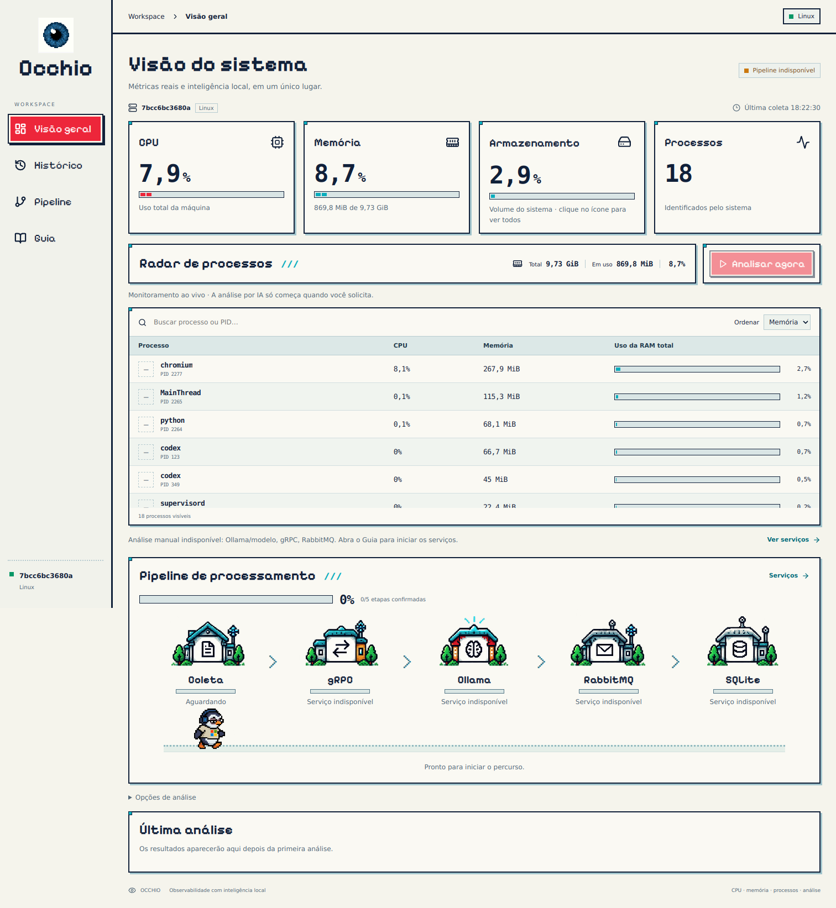

# Occhio

**A pixel-art system observatory with local AI analysis.**

Occhio is a development and testing project for exploring system telemetry, local language models, typed service contracts and asynchronous processing. It combines a React/TypeScript console with Python services, gRPC/Protocol Buffers, Ollama, RabbitMQ and SQLite.

The dashboard reads the machine running the collector. It displays real CPU, memory, storage and process data, identifies the host and operating environment, and requests installed application icons from the operating system. No example games, invented process statistics or generated application logos are shipped in the live interface.



## What it explores

- **Observability:** interval CPU sampling, resident memory, process identities and service readiness.
- **Service contracts:** unary, bidirectional streaming and server-streamed progress through gRPC.
- **Local inference:** Ollama interprets a real system snapshot using an open model.
- **Asynchronous delivery:** RabbitMQ publisher confirmation and an independent consumer.
- **Persistence:** SQLite history, message acknowledgement after storage and deduplication by analysis ID.
- **Interface design:** pixel-art stations, a walking/typing penguin, responsive layouts and reduced-motion support.

The penguin moves on a dedicated path below the stations. Each completed stage contributes 20% to the progress bar. An active operation has an indeterminate indicator; the console does not invent token progress or an estimated completion time. Storage reaches completion only after the consumer confirms a record in SQLite.

## Project structure

| Directory | Responsibility |
| --- | --- |
| `frontend/src/components` | Metrics, process radar, animated pipeline and analysis details |
| `frontend/src/assets` | Penguin/station atlases, eye mark, local font and font license |
| `backend/api` | HTTP console, process icons and incremental progress |
| `backend/services` | Metrics, process sampling, environment detection, gRPC service and consumer |
| `backend/infrastructure` | Ollama, messaging, storage and native icon extraction |
| `backend/domain` | Validation and Protocol Buffers conversions |
| `proto` | Versioned service contract |
| `tests` | Contract, API, progress, persistence and failure-path tests |
| `docs` | Architecture, installation and validation |

## Running the project

See [installation](docs/INSTALACAO.md) for initial setup. The distributed ZIP includes the built frontend. Existing installations can replace the project files, preserve `.env`, `.venv` and `data/`, stop the running services and restart:

```powershell
powershell -ExecutionPolicy Bypass -File .\scripts\start.ps1
```

Python 3.12, RabbitMQ and Ollama are required for the complete analysis pipeline. The system monitor itself works while the inference/broker services are unavailable. Run only the monitor with:

```powershell
.\.venv\Scripts\python.exe -m uvicorn backend.api.gateway:app --host 127.0.0.1 --port 8000
```

Open **http://127.0.0.1:8000**. The model configured by default is `qwen3:1.7b`; choose an installed model through `.env`.

## Real process icons and environment

On Windows, icons are extracted from observed executable files through the operating system. Linux uses installed desktop entries and available PNG application icons; macOS reads bundle icons. Access restrictions, background services and applications without an available icon show an explicit empty placeholder. There is no external logo lookup or fabricated replacement. Windows and macOS extraction paths need validation on those operating systems; this release was exercised on Linux.

CPU per process is normalized to the machine's logical CPU count. The first sample remains unknown until a second sample establishes an interval. Process memory is RSS and may include shared pages; its sum is not the same as total system memory. Capacity is displayed in GiB/MiB, calculated from actual bytes.

Hostnames and OS labels come from the collector. `OCCHIO_ENVIRONMENT` optionally provides a deployment label; otherwise the detected container, WSL or OS label is used. A remote browser sees the collector machine's processes, not its own. Loopback binding remains the default. Host/origin allowlists can be configured for a controlled network; this prototype does not supply public multiuser authentication.

## Development and validation

```bash
pip install -r requirements-dev.txt
python -m backend.generate_proto
ruff check backend tests scripts
pytest -q
cd frontend
npm ci
npm run typecheck
npm run build
```

Unit/integration tests use real loopback gRPC while isolating Ollama and RabbitMQ. For a complete real-service check, run `python scripts/verify_e2e.py` with all services active. Read [the validation notes](docs/VALIDACAO.md) for the exact scope.

- [Pixel interface and animation](docs/PIXEL_INTERFACE.md)
- [Architecture](docs/ARCHITECTURE.md)
- [Installation](docs/INSTALACAO.md)
- [Engineering decisions](docs/DECISOES.md)

The project is intended for development, experimentation and testing. The model's output is a hypothesis about observed metrics, not proof of causality. Inference runs on the configured local Ollama service; the UI does not send telemetry to an external model provider.
