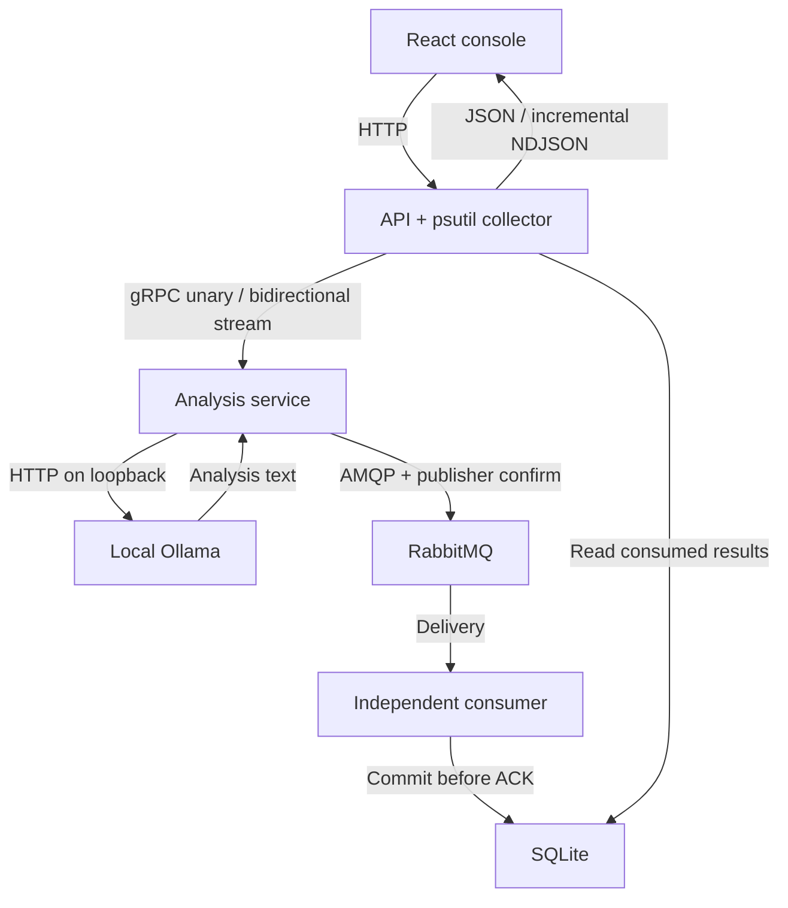

# Arquitetura

## Fluxo lógico

## Distribuição física

Uma máquina, três processos Python, um processo Ollama e um container RabbitMQ. Navegador → HTTP 8000; API → gRPC 50051; análise → Ollama 11434; análise/consumidor → AMQP 5672. Console do RabbitMQ: 15672. Todas as portas publicadas usam loopback. Em uma VM, CPU/memória/processos representam a VM.

## Contratos e responsabilidades

`proto/system_monitor.proto` é a origem dos tipos de transporte. `AnalyzeSnapshot` é unário. `StreamSnapshots` é streaming bidirecional, processado sequencialmente pelo servidor para limitar uso do modelo. A API repassa resultados incrementais por NDJSON porque o navegador não fala gRPC nativo. Cancelamento fecha a chamada; resultados já publicados não são apagados.

`domain/models.py` valida percentuais finitos, memória utilizada ≤ total, hostname, tipos e datas de coleta com fuso. O consumidor valida novamente o evento. Campos numéricos em zero são preservados na serialização Protobuf; inteiros de 64 bits podem ser representados como strings no JSON.

O prompt está em `infrastructure/ollama.py`, com versão `system-health-v1`. Recebe apenas métricas, pede português e distinção entre observação e hipótese. O modelo padrão é `qwen3:1.7b`; não há fallback para nuvem nem análise inventada quando o modelo falha.

## Mensageria e persistência

Exchange durável `occhio.events` (topic), routing key `system.analysis`, fila durável `analysis.results.v2`. Publicação com `delivery_mode=2`, `mandatory=True` e confirmação síncrona do broker. Falhas levantadas pelo cliente não são confundidas com o retorno `None` da operação.

O consumidor usa prefetch 1 e ACK após commit. Evento inválido recebe NACK sem requeue e segue ao dead-letter `analysis.failed.v2`. Erro SQLite fecha a conexão; o broker pode reentregar a mensagem não confirmada. Reconexão com espera progressiva de até 30 segundos. Não se promete exatamente uma vez: deduplicação por chave primária evita duplicação do mesmo `analysis_id`.

SQLite usa WAL, busy timeout e índice de ordenação. A tabela mantém JSON validado e `consumed_at`, adicionado apenas pelo consumidor. Confirmação do broker e confirmação de consumo são estados diferentes na interface. Um crash entre inferência e publicação pode perder aquela análise; não existe outbox nesta versão. Um novo clique cria uma nova análise.

## Concorrência e limites

API admite uma solicitação de análise por processo; outra recebe 409. gRPC admite até duas chamadas simultâneas. Streaming limita 2–10 coletas e intervalos de 0,5–5 s. Cada chamada tem deadline. Não execute múltiplos workers da API esperando que o lock local seja global. Gráficos mantêm 60 amostras na sessão, sem inventar dados anteriores.

## Segurança e observabilidade

Não expor os serviços na internet: não há autenticação, TLS ou rate limit distribuído. A API limita Host/Origin e aplica cabeçalhos de segurança. Credencial AMQP é local de demonstração. Análises são renderizadas como texto React, sem HTML arbitrário. Logs incluem IDs publicados e consumidos, sem imprimir credenciais. `/api/health` verifica transporte, modelo instalado, broker e consumidor; isso indica prontidão, não comprova uma inferência bem-sucedida.

## Referências técnicas

- https://grpc.io/docs/languages/python/basics/
- https://docs.ollama.com/api/generate
- https://pika.readthedocs.io/en/stable/modules/adapters/blocking.html
- https://www.rabbitmq.com/docs/confirms
